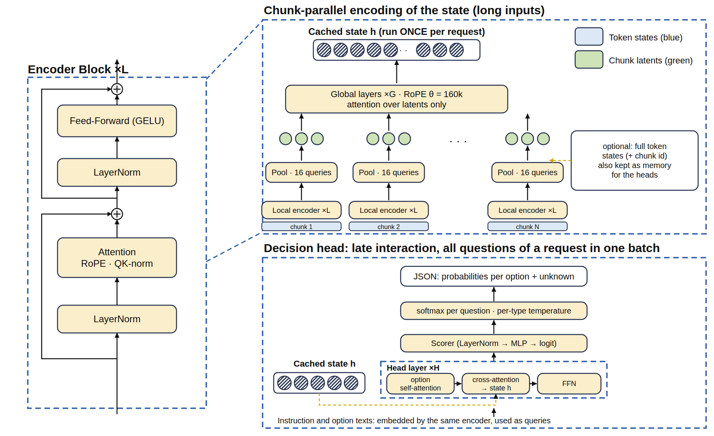

<p align="center">
  <picture>
    <source media="(prefers-color-scheme: dark)" srcset="assets/logo-lockup-dark.png">
    
  </picture>
</p>

<p align="center"><b>Non-autoregressive decision engine.</b> Typed decisions over text in a single parallel forward pass, returned as JSON probabilities. No LLM, no text generation: nothing to parse, nothing to hallucinate.</p>

<p align="center">
  
  
  
  
</p>


## Architecture

<p align="center">
  
</p>


Use the `-v2` presets. They add truncated-normal init with an embedding LayerNorm, and the v2 block (pre-norm RMSNorm, bias-free linears, SwiGLU, QK-norm).

| preset | params | notes |
|---|---|---|
| `od-tiny-v2` | 0.2M | CPU tests |
| `od-base-v2` | ~143M | default |
| `od-large-v2` | ~422M | |

On a 6-layer proxy (3 seeds), v2 vs v1: MLM eval loss 5.74 -> 3.87, Banking77 probe accuracy 0.40 -> 0.86. The v1 presets (`od-base`, ...) are unchanged and still replay bit-for-bit.

```python
from opendecision import OpenDecisionModel
from opendecision.presets import PRESETS
model = OpenDecisionModel(PRESETS["od-base-v2"])
```

Optional, off by default, behind `ModelConfig` flags:
- Gated attention: `attn_gate`.
- Document-boundary masking, span masking, ELECTRA RTD: `train.mlm_loss(eos_id=)`, `masking.span_positions`, `train.rtd_loss`.
- Top-2 MoE: `n_experts`, `top_k`.
- Long context: `local_window`, `rope_scaling`.

## Quickstart

```bash
uv venv && uv pip install -e ".[dev]"
python -m pytest -q
```

```python
from opendecision import Decider

d = Decider()  # random weights until you train or load a checkpoint
r = d.predict({
    "state": "Hi, we were billed twice for March. Refund the duplicate or we cancel.",
    "questions": {
        "department": {"type": "choice", "instructions": "Which department?",
                       "criteria": {"billing": "invoices, refunds", "technical": "bugs", "other": "else"}},
        "urgency": {"type": "score", "instructions": "How urgent?", "criteria": ["low", "medium", "high"]},
        "churn_risk": {"type": "noul", "instructions": "Does the user threaten to leave?"},
    },
})
print(r["answers"]["department"]["probabilities"])
```

Response (same shape as Laya `POST /v1/systemone`):

```json
{"model": "opendecision-0.1",
 "answers": {"department": {"type": "choice", "choice": "billing",
             "probabilities": {"billing": 0.91, "technical": 0.04, "other": 0.05},
             "unknown": 0.0, "confidence": 0.74, "answer_confidence": 0.91},
             "churn_risk": {"type": "noul", "noul": 0.89, "probabilities": {"no": 0.11, "yes": 0.89}}},
 "usage": {"input_tokens": 31, "output_tokens": 0}}
```

## Training pipeline

| Stage | Function | Purpose |
|---|---|---|
| 0 Pretrain | `train.mlm_step` | masked-token CPT; CLM->MLM 25/75 schedule for text (arXiv 2507.00994) |
| 1 Distill | `train.distill_step` | offline-cached teacher distributions (Apache teachers only) |
| 2 Fine-tune | `train.finetune_step` | strictly proper loss (log / Brier / spherical, RPS for ordinal) + optional coherence loss |
| 3 RL | `train.rl_step` | only with outcome feedback: reward `r = c - p_a`, leave-one-out baseline (unbiased half-Brier gradient, tested) |
| 4 Calibrate | `calibrate.fit_temperature`, `conformal_threshold` | per-type temperature on a disjoint split; conformal as an abstain gate, not "calibrated probabilities" |

Details: [docs/training.md](docs/training.md).

## Evaluate

Pinned baseline version, same items and criteria, zero-shot and fine-tuned reported separately, raw and post-temperature rows, per-K, paired cluster bootstrap, frozen test split, contamination flags. [docs/evaluation.md](docs/evaluation.md).

## Docs

[training](docs/training.md) · [evaluation](docs/evaluation.md) · [serving](docs/serving.md) · [economics](docs/economics.md) · [long context](docs/long-context.md) · [world knowledge](docs/world-knowledge.md) · [datasets & licences](docs/datasets.md) · [research evidence](RESEARCH.md)

## Credits

Builds on ideas from Laya (Apache-2.0), LAVOIR, eve-rlcd, ModernBERT, SigLIP 2, Perceiver IO. License: Apache-2.0.
